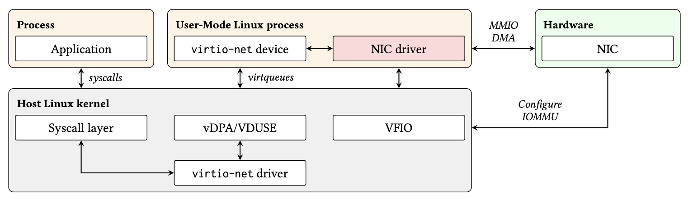

# InvirtIO

InvirtIO is a system for creating virtio devices that are backed by real Linux
device drivers running in userspace and controlling the device. This is done
by using VFIO to give device control to a userspace process that is running
User-Mode Linux with the actual Linux device driver. The UML instance then
exports a VirtIO device to the host using VDUSE.



* linux-uml holds the source code for the UML guest. There are significant
  modifications here.
* linux-host holds the source code for the host kernel. Most modifications here
  are contained to kernel modules so they can be reloaded without rebooting the
  host kernel (after installing a custom kernel in the host).

Run `./download.sh --shallow` to download the two Linux kernels and the GPU
firmware.

## Requirements

The host runs the kernel from `linux-host`, built and installed as
described in `linux-host/README.md`.

## Building

```
./download.sh --shallow
make -C launcher
make -C tools
scripts/invirtio-build-guest.sh
```

The last step builds one UML guest with every supported driver, in
`linux-uml/build-invirtio`, and its initramfs.

## Installing

```
sudo build/invirtio install -guest linux-uml/build-invirtio
```

This installs the guest, the launcher and `invirtio` itself, and the
service that runs each device's guest. Add `-n` to see the commands it
would run without running them.

## Using a device

`invirtio list` shows the host's WiFi, Ethernet and display devices, their
current drivers, and whether the guest can drive them. To move a WiFi or
Ethernet device into a guest, now and at every boot:

```
sudo invirtio enable 06:00.0
```

The host then sees a `virtio_wlan` or `virtio_net` interface in place of
the device, which NetworkManager can use as usual.

```
invirtio status
sudo invirtio console wlan-06-00-0
sudo invirtio disable wlan-06-00-0
```

`status` shows each device's guest and host interface, `console` attaches
to the guest's shell (Ctrl-] detaches), and `disable` returns the device to
its host driver. `sudo invirtio uninstall` disables every device and
removes InvirtIO.

On a machine with its WiFi card, one port of an Intel X710, and the GPU in
guests, `invirtio status` shows:

```
gpu-01-00-0 (gpu, 0000:01:00.0)
  service:         active, disabled
  host driver:     vfio-pci
  guest driver:    amdgpu
  VDUSE device:    created, on the vDPA bus
  host interface:  none
  memory:          133M, peak 162M, limit 2.50G

net-05-00-0 (net, 0000:05:00.0)
  service:         active, enabled
  host driver:     vfio-pci
  guest driver:    i40e
  VDUSE device:    created, on the vDPA bus
  host interface:  eth0 (down)
  memory:          21M, peak 26M, limit 768M

wlan-06-00-0 (wlan, 0000:06:00.0)
  service:         active, enabled
  host driver:     vfio-pci
  guest driver:    mt7921e
  VDUSE device:    created, on the vDPA bus
  host interface:  wlan0 (up)
  memory:          24M, peak 26M, limit 768M
```

The host's `vfio-pci` holds each device for its guest, the guest runs the
device's own driver, and the host uses the interface that the VDUSE device
gives it.

## GPUs

InvirtIO also supports controlling AMD GPU devices from userspace. A GPU's
guest runs `amdgpu` and exports the GPU to the host as a virtio-gpu device with
DRM native context, so host applications render on the real GPU through Mesa's
`amdgpu` virtio backend, and the guest shows the host's display manager on the
GPU's own connectors. It has been tested with the Radeon 610M iGPU of an MS-A2
(AMD Ryzen APU).

The GPU guest is separate from the WiFi and Ethernet guest. The host
applications need a Mesa built with the `amdgpu` virtio backend and a
patched libdrm, which goes to `/opt/invirtio/mesa` next to the system's
Mesa:

```
scripts/mesa-build.sh /opt/invirtio/mesa
scripts/invirtio-build-guest.sh -t invirtio-gpu
sudo build/invirtio install -guest linux-uml/build-invirtio -gpu-guest linux-uml/build-invirtio-gpu
```

`mesa-build.sh` needs Mesa's build dependencies (`apt build-dep mesa`), and
asks for sudo to copy the build into `/opt`.

To switch the display manager to the GPU's guest, run from a text console
or a remote login, since the switch ends the graphical sessions:

```
sudo invirtio enable -rom vbios.rom 0000:01:00.0
```

An APU keeps its VBIOS in the host's ACPI tables, which the guest cannot
read, so `-rom` gives the guest an image of it that was dumped on the
host. The switch stops the display manager, moves the GPU to `vfio-pci`,
starts the guest as `invirtio@gpu-01-00-0`, and starts the display manager
again once the guest's DRM card is on the host. Graphical sessions take
`/opt/invirtio/mesa` meanwhile. If the display manager does not start, the
GPU goes back to its host driver. The switch logs to
`journalctl -u invirtio-display-gpu-01-00-0`.

The switch lasts until the next boot, which always starts on the GPU's host
driver. To switch back without a reboot, again from a text console or a
remote login:

```
sudo invirtio disable gpu-01-00-0
```

# AI Assistance

The code in this project has been written and reviewed with AI assistance.
