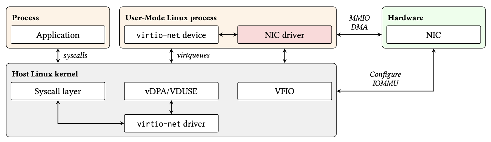

# InvirtIO

InvirtIO is a system for creating virtio devices that are backed by real Linux
device drivers running in userspace and controlling the device. This is done
by using VFIO to give device control to a userspace process that is running
User-Mode Linux with the actual Linux device driver. The UML instance then
exports a VirtIO device to the host using VDUSE.



* linux-uml holds the source code for the UML guest. There are significant
  modifications here.
* linux-host holds the source code for the host kernel. Most modifications here
  are contained to kernel modules so they can be reloaded without rebooting the
  host kernel (after installing a custom kernel in the host).

Run `./download.sh --shallow` to download the two Linux kernels and the Cloud
Hypervisor fork used by the KVM prototype (`docs/KVM.md`).

## Requirements

The host runs the kernel from `linux-host`, built and installed as
described in `linux-host/README.md`.

## Building

```
./download.sh --shallow
make -C launcher
make -C tools
scripts/invirtio-build-guest.sh
```

The last step builds one UML guest with every supported driver, in
`linux-uml/build-invirtio`, and its initramfs.

## Installing

```
sudo build/invirtio install -guest linux-uml/build-invirtio
```

This installs the guest, the launcher and `invirtio` itself, and the
service that runs each device's guest. Add `-n` to see the commands it
would run without running them.

## Using a device

`invirtio list` shows the host's WiFi and Ethernet devices, their current
drivers, and whether the guest can drive them. To move a device into a
guest, now and at every boot:

```
sudo invirtio enable 06:00.0
```

The host then sees a `virtio_wlan` or `virtio_net` interface in place of
the device, which NetworkManager can use as usual.

```
invirtio status
sudo invirtio console wlan-06-00-0
sudo invirtio disable wlan-06-00-0
```

`status` shows each device's guest and host interface, `console` attaches
to the guest's shell (Ctrl-] detaches), and `disable` returns the device to
its host driver. `sudo invirtio uninstall` disables every device and
removes InvirtIO.

On a machine with its WiFi card and one port of an Intel X710 in guests,
`invirtio status` shows:

```
net-05-00-0 (net, 0000:05:00.0)
  service:         active, enabled
  host driver:     vfio-pci
  guest driver:    i40e
  VDUSE device:    created, on the vDPA bus
  host interface:  eth0 (down)

wlan-06-00-0 (wlan, 0000:06:00.0)
  service:         active, enabled
  host driver:     vfio-pci
  guest driver:    mt7921e
  VDUSE device:    created, on the vDPA bus
  host interface:  wlan0 (up)
```

The host's `vfio-pci` holds each card for its guest, the guest runs the
card's own driver, and the host uses the interface that the VDUSE device
gives it.
